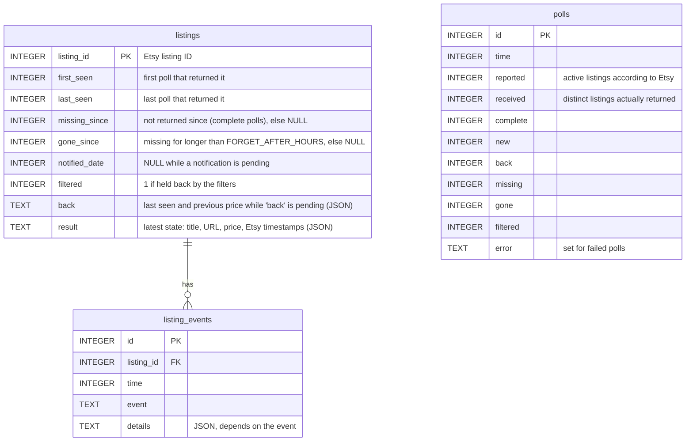

# Architecture

Shop Notify is a single, long-running Python process. It polls the Etsy Open API,
remembers which listings it has seen in a local SQLite database and sends new ones to
notification services via [Apprise](https://github.com/caronc/apprise).

<picture>
  <source media="(prefers-color-scheme: dark)" srcset="how-it-works-dark.svg">
  
</picture>

## Components

All modules are in [`src/shop_notify/`](../src/shop_notify):

| Module | Responsibility |
|---|---|
| `__main__.py` | Command line (`run`, `healthcheck`, `test-notify`, `history`, `check-filters`), logging, the poll loop (`run_once`), first-run handling, quota warning, signal handling |
| `config.py` | Settings from environment variables and `.env` ([pydantic-settings](https://docs.pydantic.dev/latest/concepts/pydantic_settings/)); credentials are `SecretStr` and never printed |
| `etsy.py` | `EtsyClient`: HTTP client for the Etsy Open API v3 ([httpx](https://www.python-httpx.org/)) with pagination, retries when rate limited, quota tracking; validates every response |
| `models.py` | `Listing` and `Money` – the only listing fields that are used and stored |
| `db.py` | `ListingStore`: SQLite database of all listings, their history and the polls, with automatic schema migration (see [Database](#database)) |
| `filters.py` | `Filters`: include/exclude rules (keywords, regular expressions) and price limits from `.env` and `filters.yml` (see [filters.md](filters.md)) |
| `notifications.py` | `MessageRenderer` (Jinja templates, en/de, plain text and HTML), `AppriseNotifier` (e-mail: one HTML mail; push/chat: one message per item with image), `ConsoleNotifier` |
| `systemd.py` | `sd_notify` messages (ready, watchdog, status) when running as a systemd service |
| `templates/` | Built-in message templates per language; can be replaced with `NOTIFY_TEMPLATE_DIR` |

## Data flow of a poll

1. `EtsyClient.active_listings` fetches all active listings of the shop, newest first,
   page by page. Each listing is validated on its own; invalid ones are logged and
   skipped.
2. `ListingStore.sync` stores the current listings, records changes of price and title
   and returns the listings to notify: new ones, those back in the shop and earlier ones
   whose notification failed.
   - A notified listing that is missing from a complete response is marked as
     *missing*; if it comes back before `FORGET_AFTER_HOURS` (24 h) nothing is sent.
   - After that it counts as *gone*. If it comes back later, it is notified as *back in
     the shop* with its previous price and when it was last seen (`NOTIFY_BACK`).
   - Etsy's count of listings is sometimes ahead of the list it returns. Such an
     incomplete response doesn't mark anything as missing; it is logged, with a warning
     after one hour, and processed anyway after `FORGET_AFTER_HOURS`.
3. The listings to notify pass through the [filters](filters.md). Those that don't
   are marked as *filtered*; while they are in the shop they are checked again on
   every poll and notified once they pass (e.g. after a title change).
4. On the first run (empty database) the new listings are only recorded and printed to
   the console.
5. Otherwise the main image of each new listing is fetched
   (`EtsyClient.listing_images`), the notification is rendered and sent to every
   target. Only after that are the listings marked as notified – if sending fails, they
   are sent again with the next poll.
6. The poll is recorded (counts, completeness, changes, errors), and a heartbeat file is updated (`healthcheck`) and, under systemd, the watchdog is
   notified. The process waits `POLL_INTERVAL` seconds and starts again.

The life cycle of a listing:

<picture>
  <source media="(prefers-color-scheme: dark)" srcset="lifecycle-dark.svg">
  
</picture>

## Database

A single SQLite file (`DB_PATH`). Listings are never deleted, events are only appended;
polls are kept for `POLL_HISTORY_DAYS`. `shop-notify history` shows the content.

All times are Unix timestamps (UTC). Events:

| Event | When | Details |
|---|---|---|
| `new` | first seen | price and Etsy's timestamps: `created`, `renewed`, `active_since`, `modified` |
| `imported` | taken over from a database of version 1.0 | – |
| `notified` / `recorded` | notification sent / only recorded (first run, `NOTIFY_BACK=false`) | – |
| `missing` | came back within `FORGET_AFTER_HOURS` | `since` (last seen), `seconds` missing |
| `gone` | missing for longer than `FORGET_AFTER_HOURS` | – |
| `filtered` | held back by the filters | `reason`, e.g. `exclude regex '^reserved\b'` |
| `back` | came back after being gone | `last_seen` |
| `price_changed`, `title_changed` | price or title differs from the last poll | `old`, `new` |

**Migrations:** the schema version is stored in `PRAGMA user_version`. On startup an older
database is upgraded automatically after a backup copy (`<DB_PATH>.bak-v<version>`) was
made; a database of a newer version is refused. Version 1 (Shop Notify 1.1) replaced the
table of 1.0 (`listing_id`, `request_date`, `notified_date`, `result`); version 2
(Shop Notify 1.2) added the `filtered` columns.

## External interfaces and trust boundaries

| Interface | Direction | Data | Trust |
|---|---|---|---|
| Configuration (`.env`, environment, `notify.yml`) | in | Etsy credentials, notification URLs with passwords and tokens | trusted – provided by the operator |
| Etsy Open API (`openapi.etsy.com`, HTTPS) | in | listing titles, URLs, prices, image URLs | **untrusted** – content is written by shop owners |
| Images (Etsy CDN, HTTPS) | in | listing pictures | **untrusted** |
| Notification services (SMTP, Telegram, ntfy, … via Apprise) | out | rendered messages and images | trusted with the content of the notifications |
| SQLite database, heartbeat and log file | local | listing IDs and fields above; no credentials | local file system of the operator |

The process opens no network ports and needs no inbound connections.

## Deployment

- **Docker** ([`Dockerfile`](../Dockerfile), [docker.md](docker.md)): multi-stage build
  with uv, runtime image without build tools and pip, non-root user `1000:1000`, data
  in the volume `/data`, built-in health check. Images for amd64 and arm64 are
  published to GHCR with SBOM and signed provenance.
- **systemd** ([systemd.md](systemd.md)): `Type=notify` service with watchdog and a
  sandboxed unit (dedicated user, read-only system, no new privileges, restricted
  system calls).
- **Locally** with `uv run shop-notify`.

## Build and release

- Dependencies are pinned in `uv.lock`; base images are pinned by digest.
- CI (GitHub Actions) runs lint, type checks, tests with 100 % coverage, secret and
  dependency scans, builds the image for both platforms, scans it and runs an
  [end-to-end test](../tests/e2e/run.sh) against a fake Etsy API and Mailpit.
- A signed tag `vX.Y.Z` on `main` triggers the release workflow (Python packages, SBOM,
  provenance, immutable GitHub release) and the publication of the images. See
  [CONTRIBUTING.md](../CONTRIBUTING.md#releasing).

Security aspects of this design are described in [security.md](security.md).
